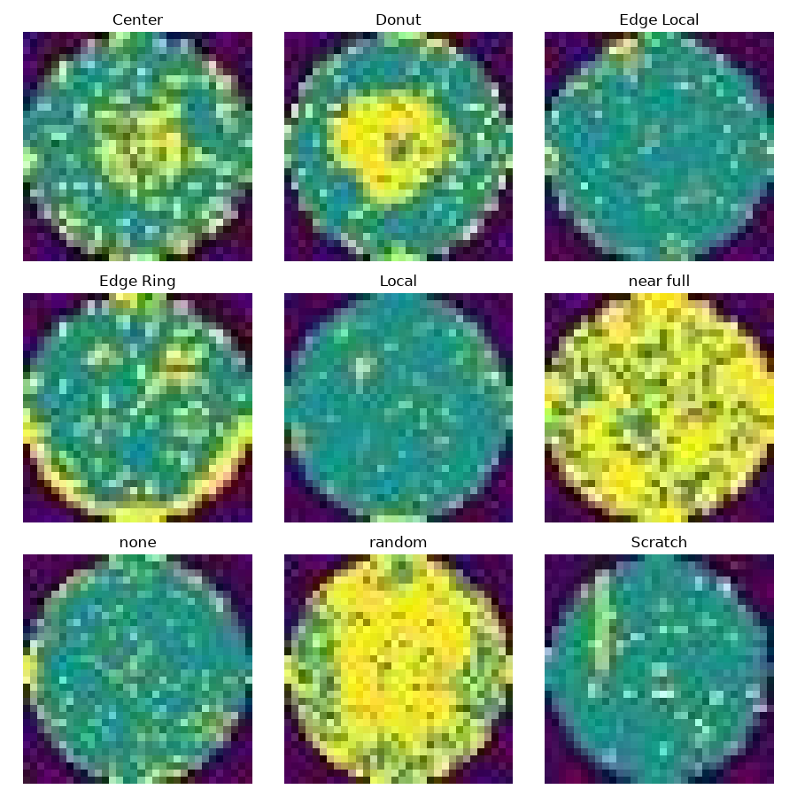
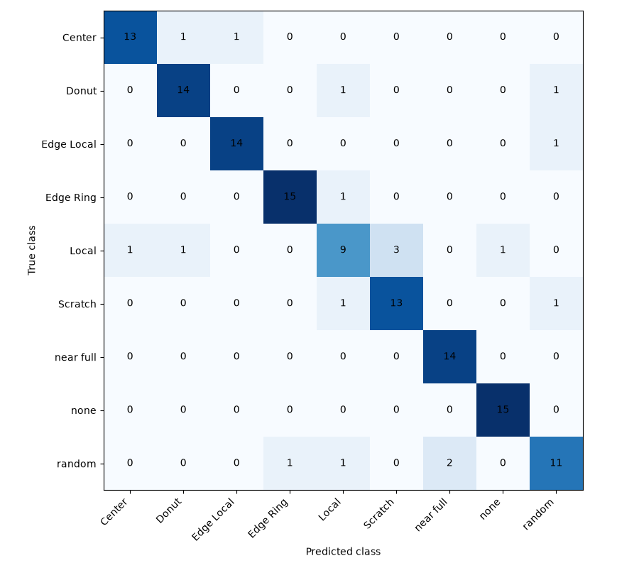

# Wafer-Map Defect Classification with a Live Camera Stream (Luckfox Pico Plus)

This project classifies semiconductor wafer-map defect patterns (Center, Donut, Edge Local, Edge Ring, Local, Scratch, Near full, Random, None) with a ResNet18 transfer-learning model trained in Python. On 136 held-out test images it reaches **86.8% accuracy and 0.865 macro F1**, up from 77.2% and 0.773 for the first model after tuning input resolution and the learning-rate schedule.

The classifier is applied to a **real-time video stream from a Luckfox Pico Plus camera**. The board streams over RTSP, and Python with OpenCV reads the stream, classifies each frame and draws the predicted class on the video, running at about **20 FPS with roughly 66 ms latency** on a CPU-only Windows PC.



> **Scope:** the data are 32 x 32 wafer-map pattern images, not SEM or optical inspection images, and the model classifies whole images instead of locating defects. In the current version the board acts as the camera and the model runs on the PC. This is a learning project, not a production inspection system.

---

## 1. Why wafer-map patterns matter

In wafer manufacturing, defects form spatial signatures across the wafer: a ring at the edge, a cluster at the center, a scratch line, random scatter. The pattern points toward the process step or equipment issue behind it, so classifying patterns supports root cause analysis and yield learning. This project is a scaled-down version of that idea.

## 2. Pipeline

```
Luckfox Pico Plus camera --RTSP--> Windows PC (Python + OpenCV) --> ResNet18 classifier --> class label drawn on live video
                                        |
                                        +--> VLC (raw stream view)
```

## 3. Tools

| Item | Detail |
|---|---|
| Language | Python 3 (virtual environment) |
| Libraries | PyTorch, torchvision, OpenCV, scikit-learn, matplotlib, Pillow, NumPy |
| Model | ResNet18 pretrained on ImageNet, last layer replaced with 9 outputs |
| Hardware | Luckfox Pico Plus (RV1103) with camera, connected to the PC over USB |
| PC | Windows, PowerShell, CPU only |

## 4. Dataset

- Source: **[FILL: dataset name, link and license]**. The images are not included in this repository.
- **902 images**, 9 classes, about 100 per class, all **32 x 32 pixels, RGB**.
- Folder layout expected: `Wafer_dataset/<class name>/<image files>`, with no ready-made train/validation/test split.

| Class | Images |
|---|---|
| Center | 100 |
| Donut | 102 |
| Edge Local | 103 |
| Edge Ring | 102 |
| Local | 100 |
| near full | 95 |
| none | 100 |
| random | 100 |
| Scratch | 100 |

The classes are nearly balanced, so no class-imbalance handling was needed.

## 5. Method

### Split
Images are divided into **631 train / 135 validation / 136 test** (70/15/15), stratified so each part keeps the same share of every class (random seed 42). The exact indices are saved in `split.json`, so every script uses the same test images.

### Model 1 (`train.py`)
Images resized to 64 x 64 and normalized for the pretrained model, with random flips and rotation (augmentation) on training images. ResNet18 with a new 9-output layer, Adam optimizer (learning rate 0.001), 15 epochs, batch size 32. The best epoch by validation accuracy is saved. Validation accuracy peaked at 86.7%.

### Model 2 (`train2.py`)
Same split, with three changes: input size 96 x 96, AdamW with learning rate 0.0003 and a cosine schedule, and label smoothing 0.1, trained for 30 epochs. Validation accuracy peaked at 90.4% and was much steadier between epochs.

The best epoch is always chosen on the validation images only. The test images are used once per model, for final reporting.

## 6. Results (136 held-out test images)

| Metric | Model 1 (64 px) | Model 2 (96 px) |
|---|---|---|
| Accuracy | 77.2% (105 of 136) | **86.8%** (118 of 136) |
| Macro F1 | 0.773 | **0.865** |

| Class | Precision | Recall | F1 (Model 2) | F1 (Model 1) |
|---|---|---|---|---|
| Center | 0.929 | 0.867 | 0.897 | 0.769 |
| Donut | 0.875 | 0.875 | 0.875 | 0.839 |
| Edge Local | 0.933 | 0.933 | 0.933 | 0.625 |
| Edge Ring | 0.938 | 0.938 | 0.938 | 0.882 |
| Local | 0.692 | 0.600 | 0.643 | 0.621 |
| Scratch | 0.812 | 0.867 | 0.839 | 0.593 |
| near full | 0.875 | 1.000 | 0.933 | 0.923 |
| none | 0.938 | 1.000 | 0.968 | 0.966 |
| random | 0.786 | 0.733 | 0.759 | 0.737 |



**Analysis**
- The largest gains came on Edge Local (F1 0.625 to 0.933) and Scratch (0.593 to 0.839), the two classes Model 1 confused most often (Scratch was frequently predicted as Edge Local).
- For Model 2 the weakest classes are **Local (0.643) and random (0.759)**.
- Three things changed between the models (resolution, learning-rate schedule, label smoothing), so this experiment cannot say which one caused the gain.
- With only 136 test images, one accuracy figure is uncertain by roughly plus or minus 6 points. The improvement is larger than that, but its exact size should not be over-read.
- The same test set was used for both models. No tuning was done against it, but it has been seen twice.

## 7. Live camera pipeline

### Board connection
1. Connect the Pico Plus to the PC with a USB-C cable. The board is reachable at `172.32.0.93` (check with `ping 172.32.0.93`).
2. The board's default image already streams the camera over RTSP at `rtsp://172.32.0.93/live/0`. Check it in VLC (Media > Open Network Stream).
3. The board has no battery clock, so its date resets to 1970 at every power-off, and the burned-in time stamp on the video is wrong. Set it from the PC before a demo:

```
$t = Get-Date -Format "yyyy-MM-dd HH:mm:ss"
ssh root@172.32.0.93 "date -s '$t'"
```

### Live classification (`live_classify2.py`)
For each frame, the script cuts a square from the center (60% of the shorter side), converts BGR to RGB, resizes to 96 x 96, normalizes, runs the model and draws the predicted class and confidence. It averages the last 5 predictions to stop flicker and shows FPS and frame delay. Press `q` to quit.

**Problem found: lag and freezing.** The board sends about 25 to 30 frames per second, but CPU inference is slower, so OpenCV's queue of unread frames grew and the picture fell behind.
**Fix:** a background thread reads the stream continuously and keeps only the newest frame, the decoder is set to low delay, and the stream reconnects automatically.
**Measured result:** about 20 FPS with roughly 66 ms frame delay on a CPU-only Windows PC.

### Known issue: the model has no "not a wafer" answer
Pointed at a dark, switched-off monitor, the live window still showed "Local 56%". The model must choose one of its 9 classes for any picture. `ood_test.py` feeds the model five pictures with no wafer (black, dark grey, mid grey, white, random noise) to check which class it falls back to. Result: **[FILL: paste the output]**. A confidence limit (`CONF_MIN = 0.60`) in the live script shows "Unsure / no wafer map" for low-confidence guesses, but this is only a patch.

## 8. Limitations

- Small dataset (902 images, 136 for testing), so results have wide uncertainty.
- Very low image resolution (32 x 32).
- Wafer-map pattern images, not real inspection images.
- The model was trained on clean digital images. Accuracy through the camera is expected to be lower than the test-set accuracy and **has not been measured yet**: **[FILL: live-camera accuracy]**.
- No "no wafer" class.
- One train/validation/test split; no cross-validation.
- The board only streams video; the model does not run on its NPU.

## 9. Planned work

1. Capture camera pictures of every dataset image (displayed on a monitor, photographed by the Pico Plus), keeping the same train/validation/test split.
2. Measure the current model on the camera test pictures to quantify the gap between clean and camera images.
3. Fine-tune on the camera training pictures and measure again; consider adding a "no wafer" class.
4. Optional: convert the model to INT8 with RKNN-Toolkit2 and run it on the board's NPU.
5. Add a short demo video or GIF.

## 10. Repository structure

```
check_dataset.py       count images per class
inspect_images.py      check image size and colour, make sample_images.png
train.py               first training run (64 px), writes split.json and model_best.pth
evaluate.py            first test-set evaluation, writes confusion_matrix.png
train2.py              second training run (96 px), writes model_v2.pth
evaluate2.py           second test-set evaluation, writes confusion_matrix_v2.png
stream_test.py         open the board's RTSP stream in OpenCV
live_classify.py       first live classifier (lags)
live_classify2.py      live classifier with newest-frame reader
ood_test.py            test the model on pictures with no wafer
split.json             saved train/validation/test indices
requirements.txt
```

Model files (`*.pth`), the dataset and the virtual environment are not stored in the repository.

## 11. How to run

```
python -m venv venv
.\venv\Scripts\Activate.ps1
pip install -r requirements.txt

# put the dataset in Wafer_dataset\<class name>\ first
python check_dataset.py
python inspect_images.py
python train.py
python evaluate.py
python train2.py
python evaluate2.py

# with the Pico Plus connected and streaming:
python live_classify2.py
```

`requirements.txt`:

```
torch
torchvision
opencv-python
scikit-learn
matplotlib
Pillow
numpy
```

## 12. Skills demonstrated

Dataset inspection, stratified splitting, CNN transfer learning, data augmentation, model evaluation (accuracy, macro F1, per-class metrics, confusion matrix), error analysis, RTSP video streaming, real-time inference with OpenCV, debugging stream latency, honest reporting of limitations.
