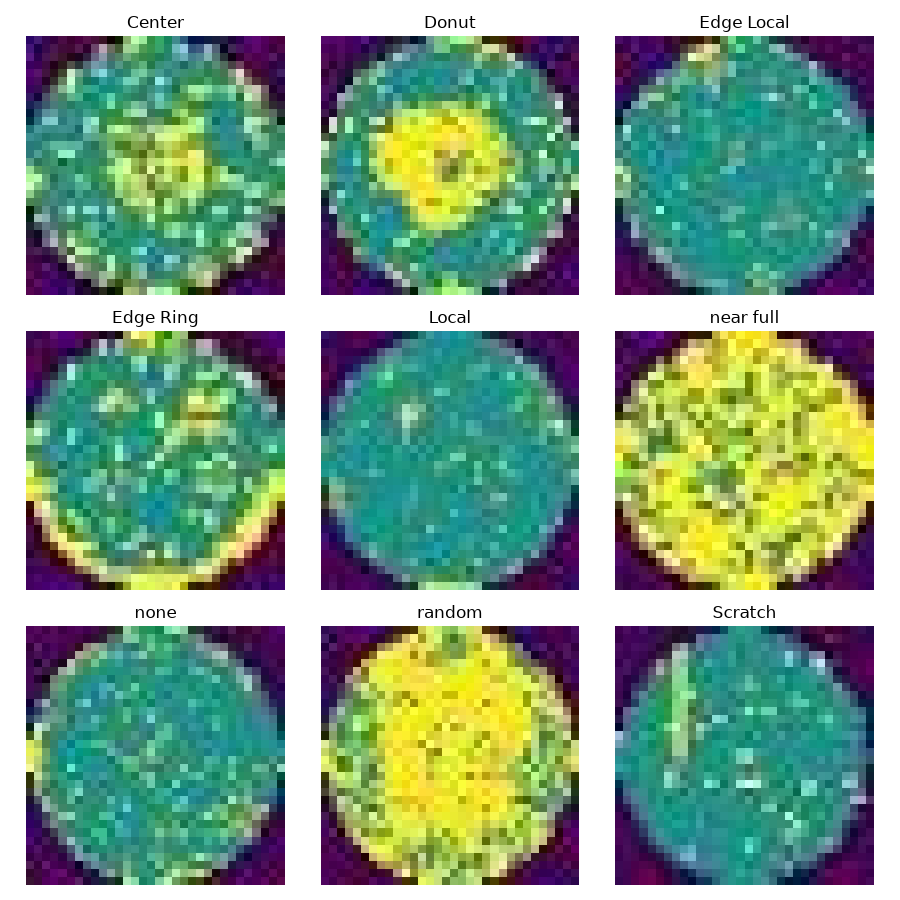
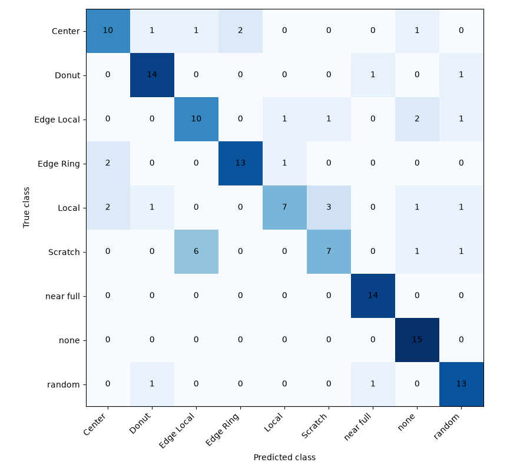

# Wafer-Map Defect Classification with a Live Camera Stream

A Python project that classifies semiconductor wafer-map defect patterns (9 classes) with a ResNet18 model, then tests it on **photos and a live video stream from a Luckfox Pico Plus camera** pointed at a monitor.

> **Scope:** 32 x 32 wafer-map pattern images (not SEM or optical inspection images). The model classifies whole images and does not locate defects. The board acts as the camera; the model runs on the PC. This is a learning project, not a production inspection system.



## Key results

| Setting | Accuracy | Macro F1 |
|---|---|---|
| Clean images, ResNet18 at 96 px (136 test images) | **86.8%** | **0.865** |
| Camera photos, model trained on clean images only (136 test photos) | 11.8% | 0.037 |
| Camera photos, after fine-tuning on camera photos (136 test photos) | **75.7%** | **0.747** |
| Live demo, 136 test images shown on a monitor (one run) | 74.3% | n/a |

- In the live demo, answers with confidence of 0.50 or higher (87% of the images) were right 79.7% of the time; the other 18 images were marked UNSURE.
- Live stream speed: about 20 FPS with roughly 66 ms delay on a CPU-only Windows PC.
- With only 136 test images, each figure is uncertain by roughly plus or minus 7 points.



## How it works

```
Luckfox Pico Plus camera --RTSP--> Windows PC (Python + OpenCV) --> ResNet18 --> class label on screen
```

1. **Clean images:** train ResNet18 (pretrained on ImageNet) on 902 wafer maps, with a stratified 631 / 135 / 136 split.
2. **Camera photos:** show every image on a monitor, photograph it with the board camera, and measure how much accuracy is lost. Fine-tune on the camera photos.
3. **Live demo:** calibrate the crop automatically, show the 136 test images one by one, classify the camera view, and score the answers.

## Repository map

```
.
├── README.md             this overview
├── requirements.txt      Python packages
├── split.json            saved train / validation / test indices
├── src/
│   ├── clean/            clean-image pipeline: dataset checks, training, evaluation
│   ├── camera/           camera photos: capture, evaluation, fine-tuning, Grad-CAM
│   └── live/             live stream, live demo, no-wafer test
├── results/              pictures used in the write-ups
└── docs/                 detailed write-ups (see below)
```

## Detailed write-ups

| Document | What it covers |
|---|---|
| [docs/clean_images.md](docs/clean_images.md) | Dataset, split, both models, per-class results |
| [docs/camera_experiments.md](docs/camera_experiments.md) | Camera capture and calibration, problems found, fine-tuning, Grad-CAM |
| [docs/live_demo.md](docs/live_demo.md) | Board connection, live stream, confidence limit, live demo results, no-wafer test |

## Quick start

Run every command from the project root (the folder with `README.md`).

```
python -m venv venv
.\venv\Scripts\Activate.ps1
pip install -r requirements.txt

# put the dataset in Wafer_dataset\<class name>\ first
python src\clean\train2.py
python src\clean\evaluate2.py

# with the Pico Plus connected, streaming, and firmly mounted facing the monitor:
python src\camera\capture_camera.py
python src\camera\train_camera.py
python src\live\demo_live.py
```

## Dataset

Source: **[FILL: dataset name, link and license]**. The images are not included in this repository. 902 images, 9 classes (Center, Donut, Edge Local, Edge Ring, Local, Scratch, near full, none, random), about 100 per class, 32 x 32 pixels, RGB.

## Main limitations

- Small dataset (902 images, 136 for testing) at very low resolution (32 x 32).
- Camera results come from one camera, one monitor and similar lighting, and the camera moved slightly during capture.
- The live demo was run once and reuses the test images shown on a monitor, so it is not a test on new wafers.
- The model has no "no wafer" answer and always picks one of its 9 classes.
- The model does not run on the board's NPU; the board only streams video.

The full list is in the write-ups above.
