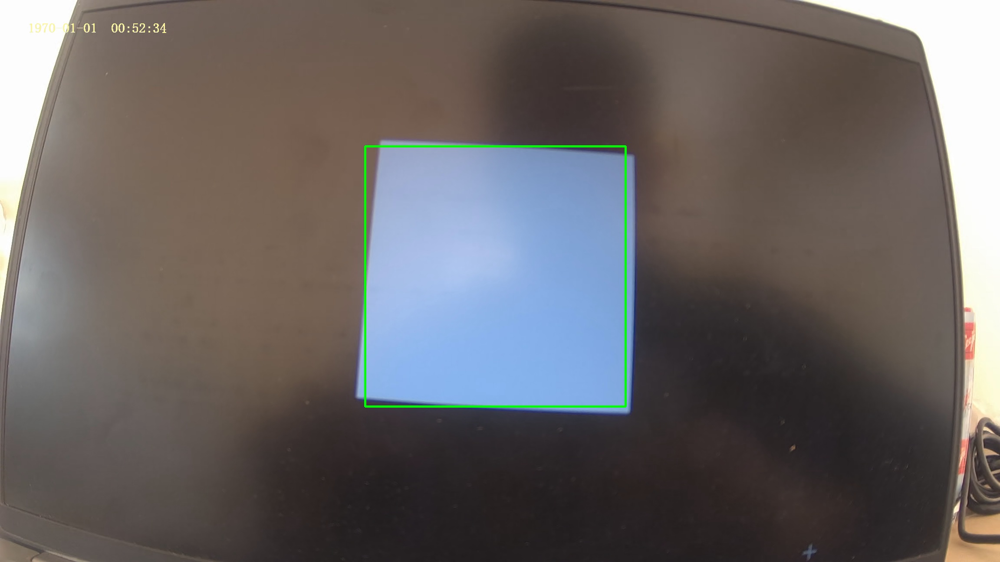
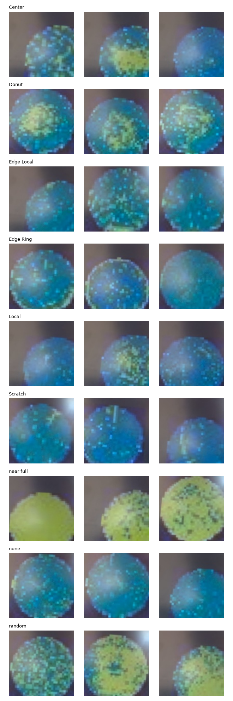
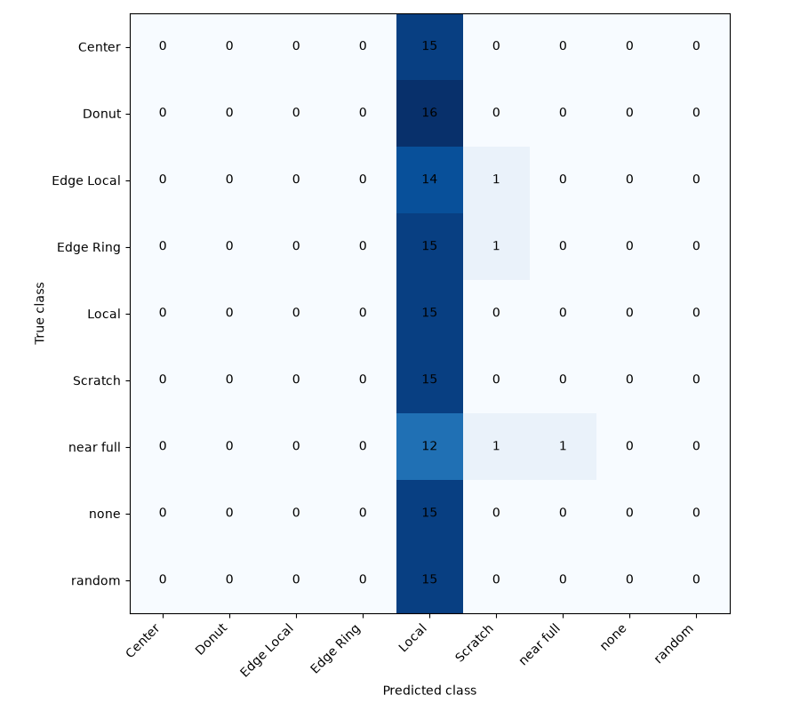
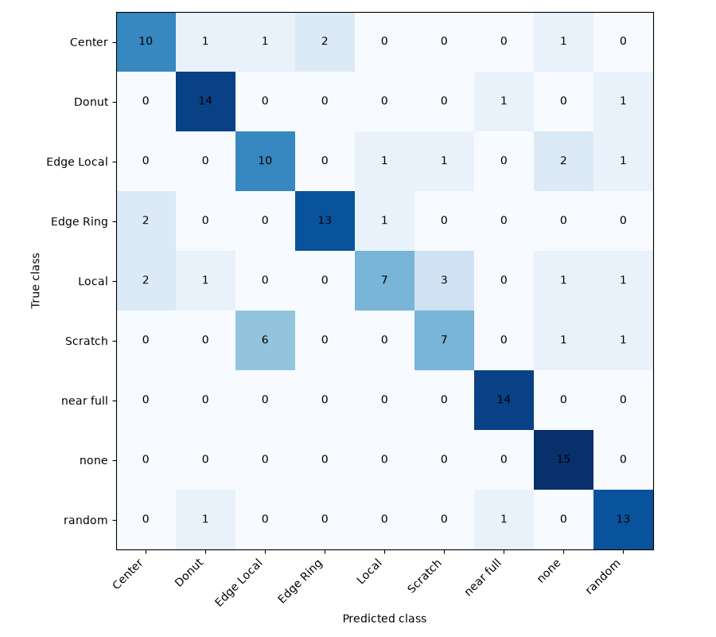
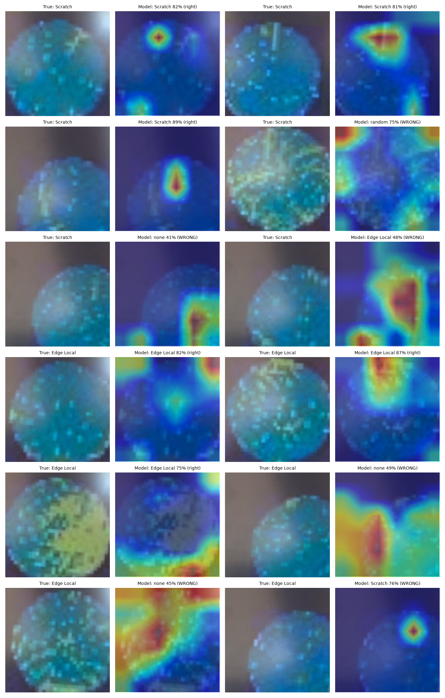

# Camera experiments

Back to the [overview](../README.md).

## Why this step

A model trained on clean digital images may fail on pictures taken by a camera: blur, different colours, glare and framing all change. To measure this, every dataset image was shown on a monitor and photographed with the Pico Plus camera.

## Capture (`src/camera/capture_camera.py`)

- The script shows each of the 902 images full screen, waits for the camera to settle, and saves the newest frame.
- **Calibration:** before capturing, the script shows a white square on a black screen, finds it in the camera picture, and crops exactly that region (128 x 128 pixels saved).
- Images are shown in random order, so lighting drift does not line up with one class.
- The photos keep the same split as the clean images: 631 train, 135 validation, 136 test. The test photos show images the model never trained on.

## Problems found along the way

1. **First capture was invalid.** Average brightness was about 120 for every class and the photos differed from the overall average by only 1.0 out of 255, so nearly all photos were the same picture: the camera was not looking at the wafer. A self-test was added, and the capture was repeated.
2. **Second capture had inconsistent framing.** The wafer sat off-centre or was cut off in many photos, because the crop was a fixed square in the middle of the camera picture and the camera view did not line up with the screen. The calibration step fixed this.
3. **The camera still moved slightly during the final capture**, so wafer position varies a little between photos. Training therefore uses random shifts and zoom.
4. The photos are blurrier and more washed-out blue than the clean images.

Results from the two rejected captures are not reported.

## Fine-tuning (`src/camera/train_camera.py`)

Starts from the clean-trained `model_v2.pth` and trains on the 631 camera training photos (25 epochs, AdamW, learning rate 0.0001, cosine schedule, label smoothing 0.1). Training photos get random flips, small rotation, shifts up to 12%, zoom from 85% to 115%, brightness, contrast and colour changes, and occasional blur. The best epoch is chosen on the 135 camera validation photos (78.5% accuracy), and the model is then tested once on the 136 camera test photos.

## Results (136 camera test photos)

| Model | Accuracy | Macro F1 |
|---|---|---|
| Trained on clean images only (`model_v2.pth`) | 11.8% | 0.037 |
| Fine-tuned on camera photos (`model_camera.pth`) | **75.7%** | **0.747** |

Before fine-tuning, the model labelled almost every camera photo as "Local" (132 of 136), which is close to chance level (11.1% for 9 classes).

| Class | Precision | Recall | F1 |
|---|---|---|---|
| Center | 0.714 | 0.667 | 0.690 |
| Donut | 0.824 | 0.875 | 0.848 |
| Edge Local | 0.588 | 0.667 | 0.625 |
| Edge Ring | 0.867 | 0.812 | 0.839 |
| Local | 0.778 | 0.467 | 0.583 |
| Scratch | 0.636 | 0.467 | 0.538 |
| near full | 0.875 | 1.000 | 0.933 |
| none | 0.750 | 1.000 | 0.857 |
| random | 0.765 | 0.867 | 0.812 |

**Analysis**

- Fine-tuning moved the model from nearly always answering "Local" to a clear diagonal in the confusion matrix. Camera test accuracy (75.7%) is about 11 points below the clean-image result (86.8%), so a gap remains.
- Strongest classes: near full, Donut, Edge Ring, none and random. Weakest: **Scratch (F1 0.538) and Local (0.583)**. Six of the 15 Scratch photos were labelled Edge Local, the same confusion seen on clean images, probably because a streak near the edge looks like an edge cluster at this resolution and blur.
- Center (F1 0.690) and Edge Local (0.625) are right about two thirds of the time.
- With 136 test photos, one accuracy figure is uncertain by roughly plus or minus 7 points.
- These results hold for this camera, this monitor and this lighting. Other cameras or screens were not tested.

## Where does the model look? (Grad-CAM, `src/camera/gradcam.py`)

Grad-CAM heatmaps were drawn for 12 camera test photos of the two classes with the most confusion, Scratch and Edge Local: the first 3 correct and the first 3 wrong photos of each, in file order. They are examples, not a random sample.

Observations (heatmaps are only a rough guide; at 96 pixel input the map has 6 x 6 cells):

- In two of the three correct Scratch photos, the strongest area lies on or near the visible streak.
- Several wrong answers are on photos where the wafer sits off-centre or is partly cut off in the crop, so some errors come from framing, not only from class confusion.
- In several photos, strong activation falls on the image corners or on glare outside the wafer, which suggests the model partly uses cues that are not wafer pattern. This has not been tested yet.
- A photo with many fine scratch lines was labelled "random" with 75% confidence.

## Scripts

| Script | Purpose |
|---|---|
| `src/camera/capture_camera.py` | Show each dataset image on screen and photograph it with the board camera |
| `src/camera/check_camera_photos.py` | Brightness statistics and a picture grid of the camera photos |
| `src/camera/eval_camera.py` | Test a model on the camera test photos |
| `src/camera/train_camera.py` | Fine-tune on camera photos, before and after evaluation |
| `src/camera/conf_check.py` | Confidence statistics on the camera validation photos |
| `src/camera/gradcam.py` | Grad-CAM heatmaps for Scratch and Edge Local |
