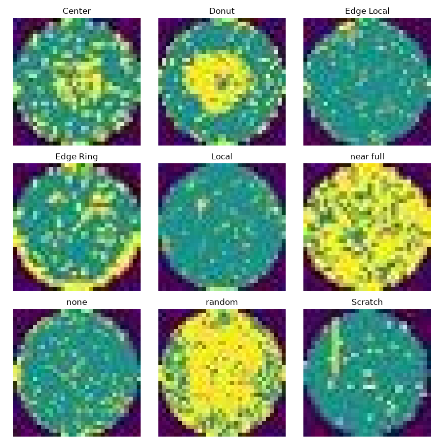
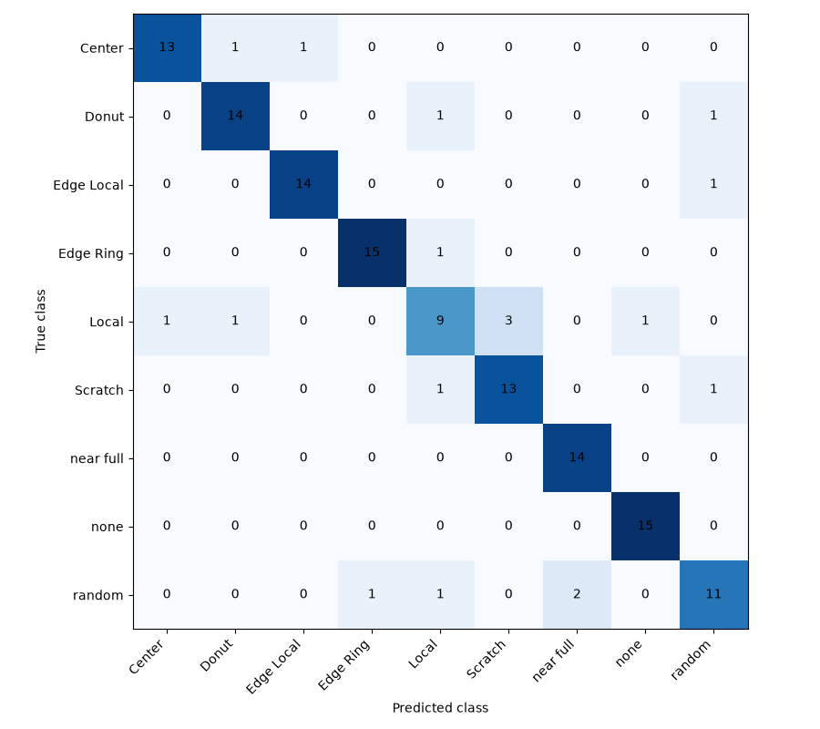

# Clean-image experiments

Back to the [overview](../README.md).

## Why wafer-map patterns matter

In wafer manufacturing, defects form spatial signatures across the wafer: a ring at the edge, a cluster at the center, a scratch line, random scatter. The pattern points toward the process step or equipment issue behind it, so classifying patterns supports root cause analysis and yield learning. This project is a scaled-down version of that idea.

## Dataset

- Source: **[FILL: dataset name, link and license]**. The images are not included in this repository.
- **902 images**, 9 classes, about 100 per class, all **32 x 32 pixels, RGB**.
- Folder layout expected: `Wafer_dataset/<class name>/<image files>`, with no ready-made train, validation or test split.

| Class | Images |
|---|---|
| Center | 100 |
| Donut | 102 |
| Edge Local | 103 |
| Edge Ring | 102 |
| Local | 100 |
| near full | 95 |
| none | 100 |
| random | 100 |
| Scratch | 100 |

The classes are nearly balanced, so no class-imbalance handling was needed.

## Method

**Split.** Images are divided into **631 train / 135 validation / 136 test** (70/15/15), stratified so each part keeps the same share of every class (random seed 42). The exact indices are saved in `split.json`, so every script uses the same split.

**Model 1 (`src/clean/train.py`).** Images resized to 64 x 64 and normalized for the pretrained model, with random flips and rotation on training images. ResNet18 with a new 9-output layer, Adam optimizer (learning rate 0.001), 15 epochs, batch size 32. Validation accuracy peaked at 86.7%.

**Model 2 (`src/clean/train2.py`).** Same split, with three changes: input size 96 x 96, AdamW with learning rate 0.0003 and a cosine schedule, and label smoothing 0.1, for 30 epochs. Validation accuracy peaked at 90.4% and was much steadier between epochs.

The best epoch is always chosen on the validation images only. The test images are used once per model, for final reporting.

## Results (136 clean test images)

| Metric | Model 1 (64 px) | Model 2 (96 px) |
|---|---|---|
| Accuracy | 77.2% (105 of 136) | **86.8%** (118 of 136) |
| Macro F1 | 0.773 | **0.865** |

| Class | Precision | Recall | F1 (Model 2) | F1 (Model 1) |
|---|---|---|---|---|
| Center | 0.929 | 0.867 | 0.897 | 0.769 |
| Donut | 0.875 | 0.875 | 0.875 | 0.839 |
| Edge Local | 0.933 | 0.933 | 0.933 | 0.625 |
| Edge Ring | 0.938 | 0.938 | 0.938 | 0.882 |
| Local | 0.692 | 0.600 | 0.643 | 0.621 |
| Scratch | 0.812 | 0.867 | 0.839 | 0.593 |
| near full | 0.875 | 1.000 | 0.933 | 0.923 |
| none | 0.938 | 1.000 | 0.968 | 0.966 |
| random | 0.786 | 0.733 | 0.759 | 0.737 |

## Analysis

- The largest gains came on Edge Local (F1 0.625 to 0.933) and Scratch (0.593 to 0.839), the two classes Model 1 confused most often.
- For Model 2 the weakest classes are **Local (0.643) and random (0.759)**.
- Three things changed between the models (resolution, learning-rate schedule, label smoothing), so this experiment cannot say which one caused the gain.
- With only 136 test images, one accuracy figure is uncertain by roughly plus or minus 6 points.
- The same test set was used for both models. No tuning was done against it, but it has been seen twice.

## Scripts

| Script | Purpose |
|---|---|
| `src/clean/check_dataset.py` | Count images per class |
| `src/clean/inspect_images.py` | Check image size and colour, make `sample_images.png` |
| `src/clean/train.py` | First training run (64 px), writes `split.json` and `model_best.pth` |
| `src/clean/evaluate.py` | First test-set evaluation |
| `src/clean/train2.py` | Second training run (96 px), writes `model_v2.pth` |
| `src/clean/evaluate2.py` | Second test-set evaluation, writes the confusion matrix |
